  

  
  
  

  <b>School of Business, University of the Cumberlands</b> · Williamsburg, KY, USA

---

## 👋 About

I research how **artificial intelligence** and **business analytics** can support real-world decisions, across
**healthcare**, **cybersecurity**, and **economic and social questions**. My work ranges from compact, explainable deep-learning models for
medical images to privacy-preserving cloud analytics and forecasting studies.

<table>
  <tr>
    <td width="20%" align="center">🩺 <b>Healthcare AI</b> 3 papers</td>
    <td width="20%" align="center">📈 <b>Business Analytics</b> 3 papers</td>
    <td width="20%" align="center">🛡️ <b>Security &amp; Privacy</b> 4 papers</td>
    <td width="20%" align="center">⚖️ <b>Economics &amp; Society</b> 2 papers</td>
    <td width="20%" align="center">🏭 <b>Industry &amp; Supply Chains</b> 3 papers</td>
  </tr>
</table>

Topic grouping is editorial navigation for the 15 publications listed on my Google Scholar profile.

## ⭐ Featured research

| | Publication | Venue |
|:-:|---|---|
| 🩺 | **[A compact texture frequency spatial gating network for oral cancer classification from clinical oral images](https://doi.org/10.1038/s41598-026-59480-0)** OCAT-Net-S: a 3.55M-parameter network with texture-frequency-spatial gating for oral-cancer photographs, evaluated with leakage-aware grouped cross-validation. | *Scientific Reports*, 2026 |
| 🩺 | **[XACT-TB: an explainable hybrid CNN–Swin Transformer framework for tuberculosis screening from chest X-ray images](https://doi.org/10.1007/s44163-026-01509-4)** Dual-branch CNN + Swin Transformer features classified by an SVM, with Grad-CAM and attention maps for every prediction. | *Discover Artificial Intelligence*, 2026 |
| 📈 | **[Explainable churn prediction in telecom with tabular ML: five-model benchmark and SHAP analysis](https://doi.org/10.1007/s44163-026-00983-0)** Five tabular learners under nested cross-validation, explained with SHAP, partial-dependence and ICE. | *Discover Artificial Intelligence* 6, 263 (2026) |
| 🛡️ | **[Efficient homomorphic encryption techniques for confidential big-data analytics over public cloud infrastructures](https://doi.org/10.1007/978-3-032-21499-7_41)** Partially, somewhat, fully and SIMD-batched FHE compared for private analytics on public clouds. | ICCCN (Springer LNNS), 2026 |

<b>📚 All 15 listed publications</b> (click to expand)

 

**Healthcare AI**
- [A compact texture frequency spatial gating network for oral cancer classification from clinical oral images](https://doi.org/10.1038/s41598-026-59480-0) · *Scientific Reports* · 2026
- [XACT-TB: an explainable hybrid CNN–Swin Transformer framework for tuberculosis screening from chest X-ray images](https://doi.org/10.1007/s44163-026-01509-4) · *Discover Artificial Intelligence* · 2026
- [Bio-Cognitive AI Systems for Predictive Healthcare Decision Support](https://doi.org/10.1109/icaft66710.2025.11453175) · ICAFT · 2026

**Business Analytics**
- [Explainable churn prediction in telecom with tabular ML five model benchmark and SHAP analysis](https://doi.org/10.1007/s44163-026-00983-0) · *Discover Artificial Intelligence* · 2026
- [Understanding the Relationship Between Data Governance and Business Analytics Success: A Case Study of Global Corporations](https://doi.org/10.52783/jisem.v9i4s.14807) · *Journal of Information Systems Engineering and Management* · 2024
- [AI-powered workforce analytics forecasting labor market trends and skill gaps for US economic competitiveness](https://doi.org/10.32996/jcsts.2024.6.5.21) · *Journal of Computer Science and Technology Studies* · 2024

**Security & Privacy**
- [Efficient Homomorphic Encryption Techniques for Confidential Big-Data Analytics over Public Cloud Infrastructures](https://doi.org/10.1007/978-3-032-21499-7_41) · ICCCN · 2026
- [Blockchain-Driven Access Control and Compliance Auditing Framework for Federated Cloud Service Providers](https://doi.org/10.1007/978-3-032-14197-2_41) · ICCCN · 2026
- [AI-augmented big data analytics for real-time cyber attack detection and proactive threat mitigation](https://doi.org/10.22399/ijcesen.3564) · *IJCESEN* · 2025
- [Enhancing Cybersecurity Threat Detection and Response Through Big Data Analytics in Management Information Systems](https://doi.org/10.52710/fcb.137) · *Fuel Cells Bulletin* · 2023

**Economics & Society**
- [Economic Implications of Homelessness in the US: Applying Advanced Business Analytics to Forecast Costs and Develop Sustainable Solutions](https://doi.org/10.1109/icecet63943.2025.11472202) · ICECET · 2026
- [Empowering Women through Microcredit: An Analysis of the Grameen Bank Model's Impact on Socio-Economic Outcomes](https://doi.org/10.22399/ijcesen.4074) · *IJCESEN* · 2024

**Industry & Supply Chains**
- [Artificial Intelligence Models for End-to-End Supply Chain Optimization](https://doi.org/10.1109/i3ctcon68242.2026.11507407) · IEEE I3CTCON · 2026
- [A Comparative Review of Machine Learning Algorithms in Supermarket Sales Forecasting with Big Data](https://doi.org/10.62754/joe.v3i8.6762) · *Journal of Ecohumanism* · 2024
- [Harnessing Business Analytics in Management Information Systems to Foster Sustainable Economic Growth Through Smart Manufacturing and Industry 4.0](https://doi.org/10.53555/kuey.v30i10.9643) · *Educational Administration: Theory and Practice* · 2024

All papers are co-authored; full author lists are on each publisher page. Years follow the Google Scholar listing.

## 🧪 Research software

| Repository | What it is | Paper |
|---|---|---|
| [**Research Universe**](https://github.com/archowdhury328-cloud/archowdhury328-cloud.github.io) | This portfolio: React, TypeScript and three interactive Three.js scenes, fully accessible without 3D | [Live site](https://archowdhury328-cloud.github.io/) |
| [**XACT-TB**](https://github.com/archowdhury328-cloud/XACT-TB) | Documented reconstruction of the CNN + Swin + SVM tuberculosis screening pipeline | [Discover AI 2026](https://doi.org/10.1007/s44163-026-01509-4) |
| [**OCAT-Net-S**](https://github.com/archowdhury328-cloud/OCAT-Net-S) | Documented reconstruction of the compact texture-frequency spatial gating network | [Sci. Reports 2026](https://doi.org/10.1038/s41598-026-59480-0) |
| [**Explainable-Telecom-Churn**](https://github.com/archowdhury328-cloud/Explainable-Telecom-Churn) | Leakage-controlled five-model churn benchmark with SHAP/PDP/ICE and a statistical audit (public-data reconstruction) | [Discover AI 2026](https://doi.org/10.1007/s44163-026-00983-0) |
| [**Efficient-HE-Cloud-Analytics**](https://github.com/archowdhury328-cloud/Efficient-HE-Cloud-Analytics) | Benchmark harness for Paillier, BFV, CKKS and SIMD packing, with a claims audit | [ICCCN 2026](https://doi.org/10.1007/978-3-032-21499-7_41) |
| [**AI-Powered-Workforce-Analytics**](https://github.com/archowdhury328-cloud/AI-Powered-Workforce-Analytics) | Statistical pipeline and published-results consistency audit | [JCSTS 2024](https://doi.org/10.32996/jcsts.2024.6.5.21) |

Reconstructions are independent research software built from the papers; each repository states what was and was not reproduced.

## 🛠️ Toolbox

  
  
  
  
  
  
  
  

## 📊 Snapshot

**15** listed publications · **146** citations · **h-index 7** · **i10-index 5**
Google Scholar snapshot supplied by the author; see [Google Scholar](https://scholar.google.com/citations?hl=en&user=mAM8u_UAAAAJ&view_op=list_works&sortby=pubdate) for current figures.

---

  <a href="https://archowdhury328-cloud.github.io/"><b>Explore the interactive portfolio →</b></a>

